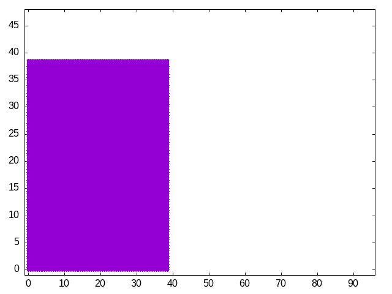
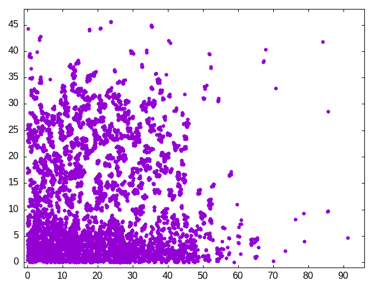
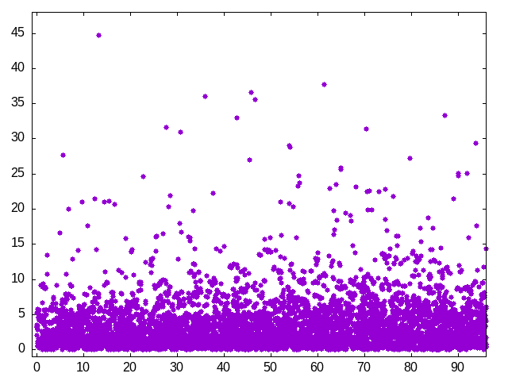
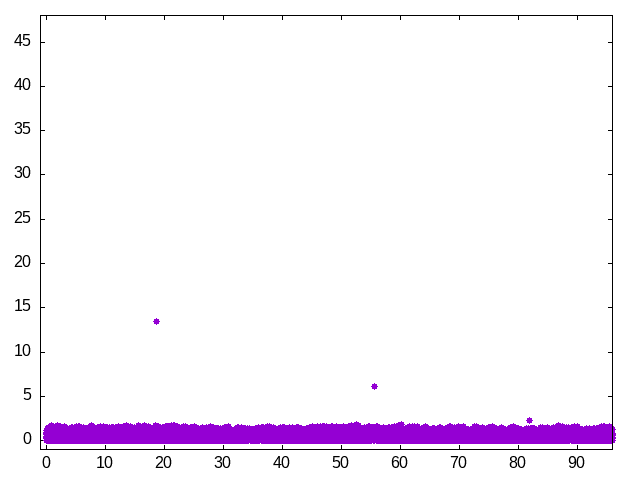

# Supercomputing At Home

I was once at a conference's poster session presenting some of my PhD results which had been obtained using a national supercomputer.
Being the responsible and devoted PhD student I was, naturally I had spent plenty of time on preparation for the upcoming questions.
My assumption of course was that the line of questioning would be perhaps related to fluid dynamics, or parallel computing, or even to finite element analysis.
To my surprise the first and only question posed to me by the session's chair was a simple "why did you need a supercomputer to solve THIS problem" -emphasis on the "this". 
And I'll admit that besides replying that we were using what we described as a massive amount of degrees of freedom, I really had no more to argue in favor of my case. 
Of course the question was not asked in bad faith, moreover it triggered a further line of questioning in my already overthinking brain. 
For instance, why do we even need a massive number of degrees of freedom? Or could we have obtained our same conclusions based on a simplified but equally meaningful problem? Also, was our software prepared to take advantage of the given hardware, both algorithmically as technically?
This short story is a brief introduction to the topic that will be explored on this post.
An appropriate technical title would have been something like "On the Importance of Algorithmic Optimization and Good Coding Practices", however I think its best to keep things casual and try to answer the posed question of "why do we need a supercomputer at all?".
For this reason, here we will explore if its not possible to avoid -at least in some measure- using a supercomputer to explore new scientific topics and instead make use of what essentially is also a supercomputer in everything but name: the laptops and desktops that most of all have at home or work and which most likely are currently in front your eyes right now. 
Is it possible to do supercomputing at home?

## Background

In order to delimitate the scope of this work, we have to choose a scientific application.
It has to be meaningful, nontrivial, and ideally not-too-boring.
So I propose to make use of a very simple discretization method called "Smoothed Particle Hydrodynamics", which finds its range in applications in fluid simulations to orbiting stars, down to video games and granular material modeling. 
So in what follows I will briefly and bluntly introduce the SPH method and describe how we make use of it to illustrate our ideas. 
For the readers that have no appetite for equations or those who simply do not make use of SPH and never will, feel free to skip to the next section where a more diagrammatic approach is followed. 

Smoothed particle hydrodynamics is a meshless discretization method, or a particle method depending on the source you consult. 
In mesh-based methods, such as FEM and all its variants, a grid is used to describe a domain -e.g., a canal where a fluid flows through. 
This grid (or mesh) is composed of elements of a certain geometry, such as triangles or squares, and in turn consist of nodes.
These characteristics impose a connection between the nodes that compose an element, the neighboring elements sharing nodes and the whole grid being in a sense "stiff" due to this connectivity.
In SPH there is none of this, the nodes, or particles, are free floating around the defined domain, with no particular connectivity between them.
Some sources describe it as saying that each particle represents a complete infinitesimal elements on its own.

In mathematical terms, we can interpolate a scalar quantity A at position x via a sum of all particle contributions:
```math
A\left(x\right)_S = \sum_j m_j \frac{A_j}{\rho_j}W\left( x-x_j,h \right)
```
understood as an iteration of all $j$ particles around $x$, using each particles density $\rho$, mass $m$, and position $x_j$. 
The function $W$ is called the smoothing kernel, which performs the interpolation within a distance $h$ called the core radius.
Similar expressions can be derived for the derivates of the scalar quantity $A\left(x\right)$, that is for $\nabla A_s\left(x\right)$ and $\nabla^2 A_s\left(x\right)$.

In order to test this technique, we decide to simulate a free surface, confined fluid for which a simplified Navier-Stokes approach suffices.
So let the acceleration per particle be given by
```math
\rho \frac{Dv}{Dt}=-\nabla \rho + \rho g + \mu\nabla^2 v
```
with $v$ the velocity of a given particle, and the right-hand-side terms are the pressure, external forces, and viscosity respectively. 
So essentially what we have to is find the forces acting on each particle.
For brevity, we give the computed forces as a list below:
1. The pressure force:
```math
f^{pressure}_i=\sum_j m_j \frac{p_j}{\rho_j}\nabla W\left( x_i-x_j,h \right)
```
2. The viscosity force
```math
f^{viscosity}_i=\mu \sum_j m_j \frac{\mu_j-\mu_i}{\rho_j}\nabla^2 W\left( x_i-x_j,h \right)
```

## A Simulation

Our case study for analysis is based on a simplified scenario in 2 dimensions, where we will try to maximize the number of molecules while attempting to limit the increase of runtime as the number of particles increases.
This means, ideally we want to run dramatically large simulations in the same time as a small one.

The way the scenario works is illustrated in Figure 1 below, where a water column is affected by gravity, pressure, and viscosity until it settles down into an oscillating fluid at the bottom of the container. 


<!--  -->

<table>
  <tr>
    <td>
      
      <p align="left">(a)Step 0</p>
    </td>
    <td>
      
      <p align="left">(b) Step 1000</p>
    </td>
  </tr>
  <tr>
    <td>
      
      <p align="center">(c) Step 4000</p>
    </td>
    <td>
      
      <p align="center">(d) Step 9999</p>
    </td>
  </tr>
</table>

**Figure 1:** Free surface example.

This simulation included 6084 molecules, our target now is to explain how we can achieve a higher number of particles in the same hardware with the promise of at least limiting the total runtime (in seconds) with respect to the increase of particle number. 

## Analysis

### Know your tools

The hardware we will be using is at first CPU with 6 ARM cores at 1.7GHz each.
Its a small system with 8GB of RAM, which we will try to exploit to the max.

### Determine performance metrics

Also, we have to be aware of what we want to improve and how to measure it.
Although we usually pay special interest to the total runtime, i.e. how fast our simulation is, let us define other performance metrics

* Floating operations per second: 

* Memory bandwidth

* Particle updates per second

We will measure the performance using commonly available tools in all linux systems. 
Moreover, we limit ourselves to tools that can be used in the command line, to avoid the need for any specifically installed graphic interfaces.
In this way our analysis is as general and simple as possible.

The first step is unfortunately a system dependent task, which is to determine which events we want to measure in our simulation run.
We will be measuring performance using an open source tool included in most (if not all) linux distributions: perf
In this case we start by using a profiling tool perf as so:

$perf list

to reveal all the possible events our system can count.
In my laptop, the important events we will focus on are:

* 

sudo OMP_NUM_THREADS=8 OMP_SCHEDULE=static OMP_PROC_
BIND=true  perf stat -r 5 -e cycles,instructions,fp_arith_inst_retired.scalar -o lists.txt sim-sph.out

### Understand what you want to achieve

### Understand the hardware

### Optimize your algorithms